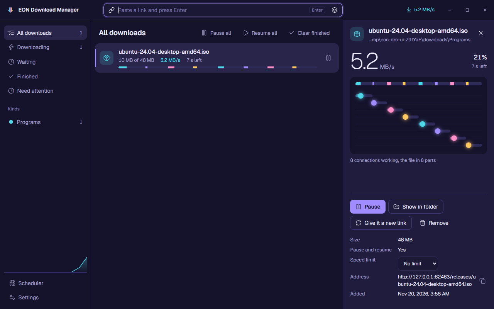

<!--
SPDX-License-Identifier: GPL-3.0-or-later
SPDX-FileCopyrightText: 2026 EON contributors
-->

# EON Download Manager

**Downloads that finish.** Several connections per file, split and rebalanced while
they run; downloads that survive a dropped line, a sleep, a crash or a power cut; a new
link for an expired one without losing a byte; your browser's downloads and the videos a
page plays, caught for you. Free, open source, no account, no telemetry — on Windows,
Linux and macOS.



> **v0.0.0** — the first alpha. Formats `v0`, early, for trying out. Builds are not signed
> yet (EON has no signing keys; plan madde 30, 34).

## What it does

- **Dynamic segmentation.** A download starts with one connection and opens more, one
  every 150 ms. Whenever a connection is free it takes the part with the most left and
  splits it in half — fast connections help slow ones until the end. Finished connections
  are reused from a keep-alive pool. A server that limits connections is noticed and
  respected, not fought.
- **Resumes after anything.** Every part's position is written to a small `.eondl` file
  beside the download at least once a second, atomically. Close the window, pull the
  plug: it continues where it was. If the file changed on the server, it starts again
  rather than mixing old and new.
- **Give it a new link.** Signed and expiring links are common. Paste a fresh one and
  every byte already downloaded is kept, if the file is the same size.
- **From your browser.** The extension (Chrome, Edge, Brave, Vivaldi, Firefox) hands over
  downloads by type or size — with that address's cookies and nothing else — and adds
  *Download with EON* and *Download all links*. Hold **Alt** to let the browser keep one.
- **The video on the page.** When a page plays an HLS stream or a media file, a *Download
  video* button appears over the player; choose a quality, done. AES-128 streams are
  decrypted. No site-specific extractors and nothing DRM-protected: EON ships a tool, not
  a content source.
- **Speed limit** for everything or per download — a real bytes-per-second limit.
- **Checksums.** SHA-256 of every finished file, and a field to compare it with a
  published one.
- **Queue and scheduler.** Downloads at the same time, start and stop times, days, and
  *sleep* or *shut down* when the queue is done — after a 60-second countdown you can stop.
- **Numbered series** (`photo[001-120].jpg`), **clipboard watching**, folders by kind,
  the tray, notifications, keyboard first (Ctrl+N, arrows, Space, Delete, Ctrl+,), English
  and Turkish, dark and light.

## Install

1. Download the file for your system from the [latest release](https://github.com/EON-Extensible-Open-Network/eon-download-manager-app/releases)
   and check it against `SHA256SUMS.txt`. Run it; there is nothing to install.
2. **Browser** (optional): in the window, *Settings → Connect browsers*. Then add the
   extension: download `eon-download-manager-extension-*.zip` from the same release,
   unzip it, and in Chrome or Edge open `chrome://extensions`, turn on *Developer mode*,
   *Load unpacked*, and choose the folder. (Store listings will come.)

On Windows, Smart App Control — if it is on — refuses unsigned downloads.

## How it is built

| | |
|---|---|
| `engine/` | The download engine: a Rust library with no GUI dependency. `plan.rs` is IDM's segmentation rule as a pure function; `transfer.rs` the connections; `hls.rs` web video; `manager.rs` the queue. |
| `src-tauri/` | The window (Tauri, the system webview), the tray, the clipboard watcher, and the browser's native messaging host — the same executable, started by the browser. |
| `src/` | The interface: static HTML, CSS and JavaScript, no bundler, no network of its own. |
| `extension/` | Manifest V3, one source for Chromium and Firefox. |

The contracts it shares with other programs — the browser hand-off and the resume state —
are in [eon-download-manager-spec](https://github.com/EON-Extensible-Open-Network/eon-download-manager-spec).

```
cargo fmt --all --check
cargo clippy --all-targets -- -D warnings
cargo test                                   # the engine against a local HTTP server
target/debug/eon-download-manager --selftest # includes a real download
node tools/ui-check.mjs --app target/debug/eon-download-manager.exe --shots shots
```

Free for everyone who downloads with it. If organisations ever pay, it will be for a
licence sold separately; this program contains no licensing code and never will (plan
madde 44). Licence: `GPL-3.0-or-later` with the [EON Module ABI Exception](LICENSE-EXCEPTION.md).
Geist font: SIL OFL 1.1. Lucide icons: ISC. Contributing: [CONTRIBUTING.md](CONTRIBUTING.md).
Security: [SECURITY.md](SECURITY.md).
